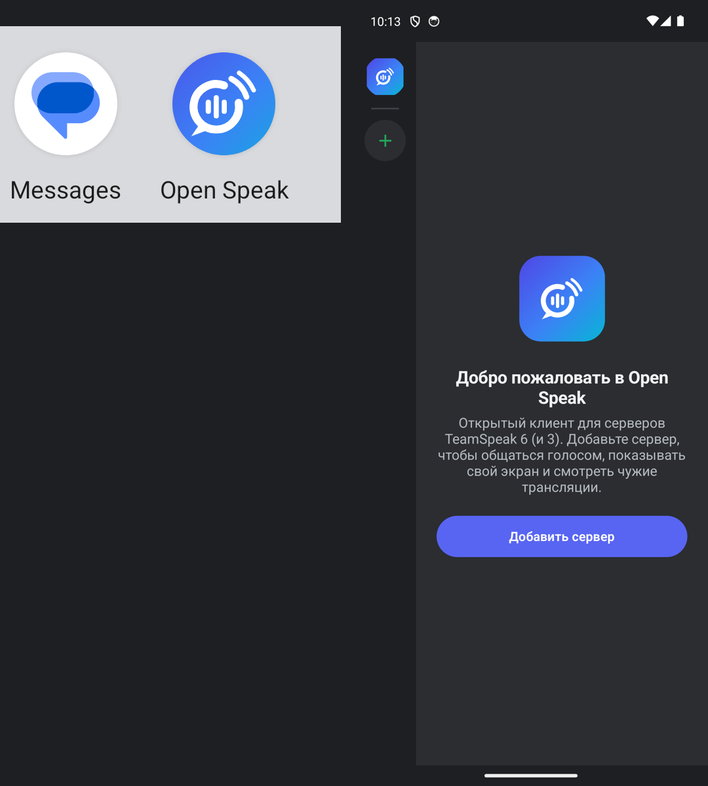
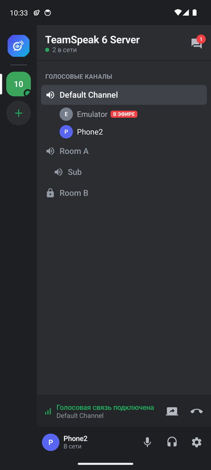
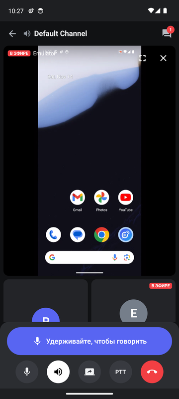

<p align="center">
  
</p>

# Open Speak

**Открытый Android-клиент для серверов TeamSpeak 6.**

Open Speak — свободная альтернатива мобильному клиенту TeamSpeak, сделанная под новую серверную
платформу **TeamSpeak 6** (проверено на `teamspeak6-server v6.0.0-beta13.1`). С серверами TeamSpeak 3
тоже работает. Голос, демонстрация экрана в обе стороны и чат — в интерфейсе в духе мобильного Discord.

<p align="center">
  
  &nbsp;
  
</p>

## Скачать

Готовый APK лежит в разделе **[Releases](https://github.com/v1svaldis/OpenSpeak/releases/latest)**:
файл `open-speak-<версия>.apk`.

1. Скачайте APK на телефон (Android 9 и новее, arm64).
2. Откройте файл и разрешите установку из этого источника, если система спросит.
3. Добавьте сервер: адрес `host` или `host:порт` (UDP 9987 по умолчанию) и ник.

Сборки подписаны отладочным ключом. С версии 0.3.0 пакет приложения — `com.v1svaldis.openspeak`,
поэтому она встанет рядом с 0.2.0 (`org.openspeak.android`) и TS4Droid отдельным приложением:
закладки серверов нужно добавить заново, а личность (identity) перенести через экспорт/импорт в настройках.

## Возможности

* **Голос.** Opus 48 кГц; режимы «нажми и говори», активация голосом с порогом, постоянная передача;
  отключение микрофона и звука (видно остальным); громкая связь или гарнитура; работа в фоне
  и с выключенным экраном.
* **Демонстрация экрана TS6.** Смотрите трансляции официальных клиентов (в плитке или на весь экран)
  и показывайте экран телефона — его видят и официальный клиент на ПК, и другие телефоны.
* **Интерфейс как в Discord.** Полоса серверов слева, голосовые каналы с участниками и метками
  «В ЭФИРЕ», панель «Голосовая связь подключена», голосовая комната с плитками участников.
* **Каналы.** Дерево каналов, переход в канал, в том числе с паролем; индикатор говорящих.
* **Чат.** Сообщения канала, личные сообщения, poke, приветствие сервера.
* **Серверы.** Закладки (адрес, ник, пароль сервера, канал при входе, ключ привилегий),
  ссылки `ts3server://host?port=…&nickname=…&password=…&channel=…`.
* **Личность (identity)** в формате TeamSpeak: экспорт и импорт совместимы с настольным клиентом.
* **Надёжное подключение.** Мгновенная отмена; понятные причины отказа (пароль, бан, переполнение);
  автоматическое ожидание, если после сбоя на сервере ещё висит старая сессия.

## Как это устроено

Сервер TeamSpeak 6 принимает клиентов по тому же голосовому протоколу, что и TeamSpeak 3
(UDP, порт 9987 по умолчанию). Отличия, важные для клиента:

* В цепочке лицензий сервера (`initivexpand2`, параметр `l`) появился блок **типа 8**
  («TS5/TS6 server license»): тип лицензии, затем список свойств `[длина][байты]`.
  Старые библиотеки (например, TS3AudioBot) на нём падают с ошибкой `Invalid license block type 8`.
  Из этой цепочки выводится открытый ключ сервера, поэтому без разбора блока рукопожатие не завершится.
* Сервер требует клиента версии **не ниже 3.6.0** и проверяет подпись версии (`client_version_sign`).
  Приложение представляется подписанной сборкой `3.6.0 [Build: 1667819930]` для Android.
* Обычный клиент не может выполнять query-команды вроде `channellist`. Дерево каналов и список
  клиентов строятся из уведомлений (`channellist`, `notifycliententerview`, `notifyclientmoved`, …),
  которые сервер присылает при входе и потом.

### Демонстрация экрана (TS6)

Сервер только пересылает сигнализацию, видео идёт напрямую между клиентами по WebRTC
(режим P2P, STUN `turn.teamspeak.com:3478`). Формат снят с официального клиента 6.0.0-beta5.1:

| Шаг | Команда / уведомление |
|---|---|
| Начать показ | `setupstream name type=2 accessibility=1 mode=1 bitrate viewer_limit audio` → всем: `notifystreamstarted clid id(UUID) …` |
| Зритель просит доступ | `joinstreamrequest id clid=<стример> is_remove=0 msg` → стримеру: `notifyjoinstreamrequest` |
| Стример отвечает offer'ом | `respondjoinstreamrequest id clid=<зритель> decision=1 offer=<SDP> msg` → зрителю: `notifyrespondjoinstreamrequest` |
| Ответ и ICE | `streamsignaling id clid=<собеседник> json=…`, где json — `{"cmd":"answer","args":{"answer":sdp}}`, `{"cmd":"offer","args":{"offer":sdp}}` или `{"cmd":"iceCandidate","args":{"sdp":"candidate:…","mid":"0","mLine":0}}` |
| Уйти / закончить | `joinstreamrequest … is_remove=1`; `stopstream id reason` → `notifystreamstopped` |
| Узнать о текущих | `requeststreaminfo clid` → `notifystreaminfo` |

Видео: [libwebrtc для Android](https://github.com/GetStream/webrtc-android) (`stream-webrtc-android`),
захват экрана — MediaProjection. При неподвижном экране Android не выдаёт новых кадров, поэтому
последний кадр повторяется дважды в секунду, чтобы новый зритель сразу видел картинку.

### Ядро на Rust

Протокол, голос и криптография — в нативном ядре [`core/`](core) на Rust (`libopenspeak_core.so`).
Kotlin отвечает только за интерфейс (Jetpack Compose), маршрутизацию звука и видео трансляций (libwebrtc).

* Протокол — [tsclientlib](https://github.com/ReSpeak/tsclientlib) (ReSpeak, MIT/Apache-2.0),
  копия лежит в `core/vendor`. Изменения: команды, которых библиотека не знает (`notifystream*` и
  прочие команды трансляций TS6), передаются в приложение «сырыми»; добавлен ключ привилегий
  (`client_default_token`) при подключении.
* Звук — AAudio: захват (VoiceCommunication, системные эхо- и шумоподавление) и воспроизведение
  в режиме низкой задержки. Opus — нативный libopus. Кадр кодируется прямо в колбэке захвата;
  джиттер-буферы и сведение собеседников — из tsclientlib, в колбэке воспроизведения.
  Никаких Java-потоков и сборки мусора на пути звука.
* Мост JNI (`NativeCore`): команды идут в ядро строками и JSON, события (состояние, снимок дерева
  каналов, чат, кто говорит, сигнализация трансляций) возвращаются JSON-объектами.

По сравнению с 0.2.0 (Java: ts3j + Concentus) релизный APK стал в 5 раз меньше:
**10,8 МБ вместо 55 МБ** (arm64, R8, сжатые нативные библиотеки).

## Сборка

Нужны JDK 17, Android SDK (platform 35, build-tools, NDK 27.2.12479018, CMake 3.22.1) и Rust
с целями Android:

```bash
rustup target add aarch64-linux-android x86_64-linux-android
```

Пути к NDK в [`core/.cargo/config.toml`](core/.cargo/config.toml) записаны под машину автора —
поправьте их под свою. Gradle сам вызывает `cargo build --release` для каждой ABI и кладёт
`libopenspeak_core.so` в APK:

```bash
./gradlew :app:assembleDebug
```

```bash
./gradlew :app:assembleRelease -PrustAbis=arm64-v8a
```

По умолчанию собираются arm64-v8a и x86_64 (для эмулятора); `-PrustAbis` оставляет только нужные.
APK: `app/build/outputs/apk/<debug|release>/`. Релиз подписан отладочным ключом.

На Windows для сборки Rust нужен MinGW-w64 (тулчейн `stable-x86_64-pc-windows-gnu`).

## Инструменты для проверки без телефона

* `cargo run --example desktop_probe -- 127.0.0.1:9987` (в `core/`) — ядро на ПК: подключение,
  события в консоль, объявление трансляции.

Модуль `ts3j` (Java-стек версии 0.2.0) остался только ради тестовых утилит в `ts3j/src/test`:

* `./gradlew :ts3j:runProbe -Phost=127.0.0.1` — два клиента: дерево каналов, тестовый тон 440 Гц от одного,
  второй проверяет, что получил и декодировал звук.
* `./gradlew :ts3j:runSetup -Ptoken=<ключ админа>` — создаёт тестовые каналы Room A, Sub и Room B (пароль `123`).
* `./gradlew :ts3j:runCompanion -Pseconds=120` — второй участник: каждые 6 с говорит тоном и
  выводит, сколько голосовых пакетов услышал от каждого клиента.
* `./gradlew :ts3j:runSniffer -Plog=capture.log` — подключается к каждой трансляции на сервере и пишет
  всю её сигнализацию в файл (так был снят формат официального клиента).

## Что проверено (эмулятор Android 14, сервер TeamSpeak 6 beta13.1, официальный клиент 6.0.0-beta5.1)

| Проверка | Результат |
|---|---|
| Просмотр демонстрации экрана официального клиента с телефона | видео идёт, WebRTC соединяется за ~0,1 с |
| Показ экрана телефона, просмотр в официальном клиенте | официальный клиент показывает экран телефона |
| Показ экрана телефон → телефон | работает, неподвижный экран тоже виден |
| Отмена подключения к недоступному серверу | возврат на главный экран меньше чем за секунду |
| Голос: приём, передача (PTT / «Всегда»), индикатор разговора | работает |
| Отключение микрофона | другие видят `client_input_muted=1` |
| Чат канала, приветствие сервера | работает |
| Переход в канал / неверный пароль / верный пароль | работает / «invalid channel password» / работает |
| Повторный вход после убитого процесса («too many clones») | приложение ждёт, пока старая сессия истечёт, и подключается |
| Сервер пропал | через ~30 с сообщение «Соединение с сервером потеряно» |

## Ограничения

* Не реализованы: камера, звук трансляции (показ экрана идёт без звука), шёпот (whisper),
  передача файлов и аватары, создание и редактирование каналов.
* Трансляции — только режим P2P. Режим SFU (через WebRTC-сервер TS6, `--enable-webrtc-server`) не поддержан.
* P2P между сетями за строгим NAT может не соединиться: TURN-сервера нет, только STUN.
* Поддерживаются только кодеки Opus (Voice и Music) — стандартные для TeamSpeak 5/6.
* Если сервер требует более высокий уровень безопасности личности, ядро повышает его само
  (не проверено на сервере с повышенным требованием).
* Причина отключения сервером (кик, бан) пока не показывается: только «Соединение закрыто сервером».
* Пароль сервера передаётся хэшем, как у официальных клиентов; на сервере с паролем не проверялось.
* Всё проверено в эмуляторе; качество звука и видео нужно оценить на реальном телефоне.

Open Speak — независимый проект, не связан с TeamSpeak Systems GmbH. TeamSpeak — товарный знак его владельца.

## История версий

### 0.3.0 — ядро на Rust (ветка `rust`)

* Протокол, голос и криптография переписаны на Rust (tsclientlib, libopus, AAudio); Java-стек
  ts3j и Concentus больше не входят в приложение.
* APK: 10,8 МБ вместо 55 МБ (arm64, R8 и сжатие ресурсов).
* Пакет приложения — `com.v1svaldis.openspeak`; минимальная версия Android — 9.

### 0.2.0 — Open Speak
* Демонстрация экрана TeamSpeak 6: просмотр и показ, совместимо с официальным клиентом 6.0.0-beta5.1.
* Новый интерфейс в стиле мобильного Discord.
* Проект переименован в Open Speak, новая иконка (applicationId `org.openspeak.android`).
* «Отмена» при недоступном сервере больше не зависает.
* Переподключение после сбоя не упирается в защиту сервера от флуда.

### 0.1.0 — TS4Droid
* Первая версия: подключение к TeamSpeak 6, голос, каналы, чат.
